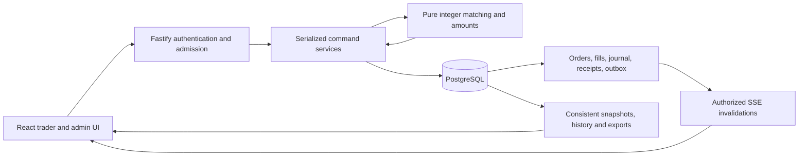
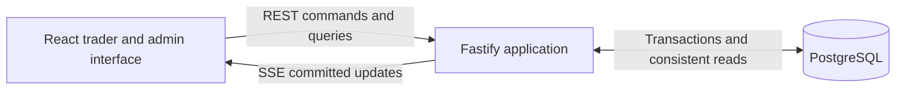

# System architecture and stack

Status: accepted architecture and TypeScript stack, based on the accepted [MVP](MVP.md). Milestones 1–3 implement the trading core, PostgreSQL persistence/recovery, invitation-only authentication, trader/admin HTTP routes and screens, audited controls, and live delivery. The two-account simulator now has administrator lifecycle/funding controls and browser regression coverage. Protected market orders now share the transactional engine and have server-bound previews. Session rollover, retained archives, complete history reads, and coherent exports are implemented. Self-host packaging and operational verification are described in [release verification](RELEASE.md). Exact dependencies are pinned in the manifests and lockfile. See [development and validation](DEVELOPMENT.md) and the [HTTP API](API.md) for the implemented boundary.

Use a modular TypeScript application, a React interface, and PostgreSQL as the authoritative store. The browser uses ordinary HTTP commands and queries and server-sent events for live updates. The implemented core uses exact integer arithmetic and one serialized database transaction for each exchange command. The initial deployment has one application process and one database.

This favors inspectable correctness, a small installation, and approachable contributions. It accepts a throughput ceiling and a single application failure domain. Spot Exchange Simulator has one virtual market; it does not need a distributed trading platform to meet its product contract.

## Implemented command and read paths



A trading command commits its financial records, receipt, and notification evidence together. A lost response is resolved through the same command identity. SSE tells the client to read authoritative state; it never supplies invented balances or optimistic executions. Session rollover uses the same boundary for its final financial transition after publishing a durable recovery gate.

## Architecture options

| Option                                                                | Main benefit                                                                            | Cost for this MVP                                                                                                                           | Recommendation                                                                 |
| --------------------------------------------------------------------- | --------------------------------------------------------------------------------------- | ------------------------------------------------------------------------------------------------------------------------------------------- | ------------------------------------------------------------------------------ |
| Modular application with transactional database matching              | One commit can cover an order, both participants, fees, history, and the command result | Commands serialize; database latency limits throughput                                                                                      | Choose for MVP                                                                 |
| Authoritative in-memory engine with durable command log and snapshots | Direct control over execution latency; efficient book operations                        | Must solve durability-before-acknowledgement, deterministic replay, snapshot compatibility, and synchronization with accounting and queries | Consider only after measured need or a deliberate shift toward engine research |
| Separate matching, wallet, identity, market-data, and admin services  | Independent deployment and scaling                                                      | Financial operations cross service boundaries; installation and recovery need substantially more coordination                               | Defer                                                                          |

A modular application still has explicit domain boundaries. Modules communicate through application services and typed interfaces, not arbitrary database writes. Deployment boundaries can change later without pretending that a future engine extraction will be free.

Full event sourcing is also deferred. Immutable ledger entries, order events, command receipts, and an event outbox provide explanation and reliable notification, while committed relational state remains authoritative. Recovery does not require replaying every historical user command.

## Backend language options

| Option                              | Strength for this product                                                 | Principal tradeoff                                                                                        | Fit                                                           |
| ----------------------------------- | ------------------------------------------------------------------------- | --------------------------------------------------------------------------------------------------------- | ------------------------------------------------------------- |
| TypeScript and Node.js              | One language for UI, contracts, domain rules, bot, and most tests         | Requires strict numeric conventions, runtime validation, and bounded synchronous work                     | Best default                                                  |
| Go with a TypeScript UI             | Explicit server code, compiled backend artifact, useful concurrency tools | Two toolchains and generated transport contracts; exactness and transaction correctness still need design | Strong alternative if learning Go is a project goal           |
| Java or Kotlin with a TypeScript UI | Strong transactional ecosystem and exact-number facilities                | More framework/runtime/build surface for this small installation                                          | Good when JVM expertise or experience is an explicit priority |
| Rust with a TypeScript UI           | Strong ownership and error-handling tools; valuable systems practice      | More work to deliver the complete product; memory safety does not establish accounting correctness        | Choose for a Rust-focused project                             |
| Python with a TypeScript UI         | Productive domain development and exact arithmetic options                | Separate language/contracts, with no particular simplification of this interactive product                | Viable, but not the default                                   |

These are fit judgments, not benchmark results. Every option can implement the MVP correctly. Database transaction boundaries and domain invariants matter more than the language's headline performance. At the proposed serialized database boundary, changing Node.js to Go alone would not remove the main throughput limit.

## Recommended stack

| Responsibility                 | Recommendation                                                                        | Reason                                                                                                 |
| ------------------------------ | ------------------------------------------------------------------------------------- | ------------------------------------------------------------------------------------------------------ |
| Frontend                       | React, strict TypeScript, Vite                                                        | A private interactive application with explicit routing and data flow                                  |
| Routing and server reads       | React Router and TanStack Query                                                       | Keep navigation and fetched state explicit; component state is sufficient for forms                    |
| UI foundations                 | Tailwind CSS and a small set of Radix primitives                                      | Build the original interface with reusable controls; keyboard and accessibility checks remain required |
| Chart                          | Lightweight Charts                                                                    | Render internal execution candles without a hosted data dependency                                     |
| Backend                        | Node.js 24 LTS and Fastify                                                            | Shared language, schema-based HTTP boundaries, modular server composition                              |
| Request and response contracts | TypeBox JSON Schemas and OpenAPI                                                      | Runtime validation, response allowlists, TypeScript inference, and a language-neutral documented API   |
| Database                       | PostgreSQL 18                                                                         | Transactional matching, exact storage, locking, consistent snapshots, and operational tooling          |
| SQL access                     | Kysely with the node-postgres driver                                                  | Typed SQL with visible transactions and explicit locking; reviewed migrations                          |
| Live updates                   | REST plus SSE                                                                         | Commands have durable HTTP results; server updates flow over one authenticated stream                  |
| Authentication                 | Opaque PostgreSQL-backed sessions, secure cookies, maintained Argon2id implementation | Username-only access with direct revocation and no hosted identity dependency                          |
| Tests                          | Vitest, fast-check, real PostgreSQL integration tests, Playwright                     | Domain invariants, database races, and observable user flows                                           |
| Repository tooling             | pnpm workspaces, strict TypeScript checks, linting, formatting                        | One repository and a small set of package boundaries                                                   |
| Deployment                     | Docker Compose for application and PostgreSQL                                         | A reproducible self-host installation without a cluster                                                |

Node's official release table identifies 24 as LTS. PostgreSQL's current documentation identifies 18 as the stable line. Use reviewed patches and a lockfile, not floating latest tags. Recheck this baseline if implementation begins after these versions cease to be appropriate. [Node releases](https://nodejs.org/en/about/previous-releases), [PostgreSQL documentation](https://www.postgresql.org/docs/current/)

Fastify supports runtime schemas and TypeBox type providers; static TypeScript types do not replace those checks. Kysely provides an explicit transaction API; all queries participating in a command must use its transaction connection. [Fastify schemas](https://fastify.dev/docs/latest/Reference/Validation-and-Serialization/), [type providers](https://fastify.dev/docs/latest/Reference/Type-Providers/), [Kysely transactions](https://kysely.dev/docs/examples/transactions/simple-transaction), [node-postgres transactions](https://node-postgres.com/features/transactions)

Lightweight Charts requires its notice and TradingView attribution/link to be preserved. Its chart library will display our data; it does not supply market prices. [Official chart repository](https://github.com/tradingview/lightweight-charts)

### Other framework and storage choices

- Vite is preferred to Next.js for this authenticated workspace: there is no MVP requirement for search-engine rendering or server-rendered content. Next.js is viable, but its server features would overlap the dedicated exchange API. Vite supplies both a development server and static builds. [Vite guide](https://vite.dev/guide/)
- Fastify is preferred to Express because request/response schemas and plugin boundaries are part of the chosen design. NestJS would provide more prescribed structure, at the cost of additional framework conventions. Domain logic will remain independent of either framework.
- Kysely is preferred to a large object-mapping layer because transaction scope, row locking, and exact-value conversion should be easy to inspect. Prisma or Drizzle could work; adopting either would not remove the need to review the generated SQL and locking semantics.
- SQLite is a credible alternative for a smaller local-only sandbox, but PostgreSQL is selected for this shared operator/trader workload and its consistent export/recovery design. Supporting two databases would double important concurrency validation work.
- Redis, Kafka, RabbitMQ, a separate cache, a time-series database, GraphQL, and Kubernetes have no required role in this MVP. Revisit a dependency when a measured or newly accepted requirement justifies it.

## Runtime topology



The application process contains HTTP handling, authentication, command orchestration, read queries, and event delivery. An administrator-managed simulator runs in this process, submitting ordinary commands for two dedicated trading accounts. The self-host package uses Caddy to serve the built frontend and proxy HTTP/SSE from one HTTPS origin. Development runs Vite and the backend in development/watch mode, with Vite proxying API and SSE requests.

There is one supported application instance. A database-held singleton guard prevents accidentally starting a second active bot scheduler/application writer. Acquiring ownership also advances a writer epoch under the installation control-row lock. Every exchange or access-changing command verifies its instance's epoch under that lock; a previous instance cannot continue writing through pooled connections after ownership has changed. Loss of the guard makes the instance unready and stops command/bot dispatch. Ownership acquisition and recovery are ordered after any transaction already holding the control lock. An in-process mutex is not the persistence guarantee. Active-active deployment and automatic failover are excluded.

## Modules and dependencies

| Module                      | Owns                                                                          | Boundary                                                                          |
| --------------------------- | ----------------------------------------------------------------------------- | --------------------------------------------------------------------------------- |
| Identity and access         | Users, roles, credentials, invitations, recovery, login sessions              | Resolves actors and permissions; cannot edit trading balances directly            |
| Exchange domain             | Exact amounts, order rules, matching, fees, reservations, self-trade behavior | Pure deterministic functions; no HTTP, SQL, timers, or hidden clock reads         |
| Command application service | Admission, serialization, idempotency, transaction orchestration              | Only route for orders, fills, allocations, pause/resume, and session changes      |
| Accounting                  | Balanced journal entries and bucket changes                                   | Every financial change is attributable and committed with its originating command |
| Market queries              | Book snapshots, trades, candles, order explanations, history                  | Reads committed data; no independent trading authority                            |
| Operations                  | Pause/resume, restrictions, grants, bot control, rollover, reconciliation     | Uses the command boundary, including administrator actions                        |
| Bot                         | Fixed quoting decisions and scheduled requests                                | Submits through the same application service with its own participant identity    |
| Market simulator            | Bounded fictional prices, two automated participants, durable cycle progress  | Uses ordinary trading commands; never writes fills, candles, or balances directly |
| Delivery and exports        | Authorized SSE notifications and consistent CSV exports                       | Cannot fabricate an order outcome or override database state                      |

Repository boundaries, including planned components:

```text
apps/web/                 React views and client state
apps/server/              HTTP, command services, queries, auth, bot, operations
packages/domain/          Pure trading and accounting rules
packages/contracts/       Transport schemas and generated client types
packages/database/        Migrations, typed SQL, transaction adapters
tests/integration/        PostgreSQL concurrency and recovery cases
tests/browser/            Trader and admin browser flows
docs/                     Product and technical decisions
```

Share transport contracts and exact formatting helpers where useful. Do not expose database row types as API types or bundle server internals into the browser. Separate modules within the server before introducing additional package or deployment boundaries.

## Command acceptance and atomic matching

Use PostgreSQL Read Committed transactions with a lock on one persistent installation control row. Every command affecting orders, reservations, balances, admission restrictions, market state, or session membership acquires that lock before reading mutable exchange state. This row survives session rollover.

The lock deliberately serializes exchange mutations. Concurrent reads remain possible. The application assigns an acceptance sequence while holding the lock; priority follows that sequence, not browser time or arrival at an HTTP socket. This use of explicit locking depends on every relevant writer following the same boundary. [PostgreSQL locking](https://www.postgresql.org/docs/current/explicit-locking.html)

Migration `007_command_timestamps` changes future evidence defaults to a transaction-local PostgreSQL wall-clock value captured once after serialized admission. Orders, fills, journals, receipts, events, and mutable command state share that value. It describes admission, not commit completion; acceptance sequence still determines priority. Rollover has separate gate and completion transactions, each with its own capture. Existing records are unchanged. Authentication and preview expiry continue checking actual wall clock at the decision point, rather than a captured command or transaction-start time.

For a normal order command:

1. Authenticate, validate request shape and decimal strings, and identify the submitted command ID and intended exchange session.
2. Begin a transaction, acquire the installation lock, and recheck writer epoch, local admission health, current actor authorization, and account restrictions. Middleware checks alone are insufficient.
3. Look for an existing receipt for this actor and command ID. Return the original result for an identical payload, including after session rollover or preview expiry. Reject reuse with a different payload.
4. For a new command, validate current session, recovery/rollover gates, market state, preview where required, funds, and order limits.
5. Allocate the command/acceptance sequence. Query eligible resting orders in price/time order and pass their state into the pure matching rules. Do not use SKIP LOCKED to bypass a better-priced or earlier order.
6. Persist orders, fills, reservations, both participants' accounting entries, fees, balance projections, explanation events, the command receipt, and notification records in this one transaction.
7. Commit before reporting acceptance or publishing updates. A domain rejection also produces a durable rejected receipt, without reserving funds. Authentication failures and malformed requests are ordinary HTTP failures.

Business rejection and a failed transaction are different. Before commit, a crash leaves no accepted trade. After commit but before the response, a retry with the same identity retrieves the result. Network delivery is not exactly once; the persisted effect is idempotent for that identity. A missing receipt during an unresolved request is not proof that the original command has finished failing.

Keep transactions free of network calls, password hashing, browser interaction, or outbound event delivery. Use deterministic lock ordering after the control row. Limit lock wait and request backlog; overload fails explicitly and does not leave a hidden order scheduled for much later. An observed disconnect or expired admission deadline while waiting must prevent a later mutation. After admission, or when a transport loss has not yet been observed by the server, resolve the uncertain result through the original command receipt.

The open book initially comes from indexed order rows rather than an authoritative in-memory tree. Index session, side, status, price, and acceptance sequence. Any read cache is disposable and must not decide fills. This reduces recovery complexity, while accepting database work on the execution path.

## Accounting and exact numbers

Use branded scaled-integer values backed by TypeScript bigint in the domain. Decimal strings cross HTTP/JSON boundaries. Reject monetary JSON numbers instead of coercing them into strings during schema validation. Database values are read as strings and converted explicitly. Ordinary JavaScript numbers are never used for financial decisions, reservations, fees, or persistence. Large sequence values and stream cursors also cross the wire as strings or opaque identifiers.

| Value                   | Unit                     |
| ----------------------- | ------------------------ |
| BTC-SIM quantity        | 0.0001 BTC-SIM           |
| Order price             | 0.01 USD-SIM per BTC-SIM |
| USD-SIM balance and fee | 0.000000001 USD-SIM      |

For quantity units q and price units p, the accepted MVP rules give exact quote-unit arithmetic:

```text
fill notional = q * p * 1000
fee for each participant = q * p
buy reservation at its price cap = q * p * 1001
```

Price guards also use integer division with the specified floor/ceiling. Chart coordinates can use bounded approximate numbers for display; chart conversions never flow back into order entry, accounting, or exports. Financial labels and details retain exact decimal strings. Native bigint has different JSON behavior from ordinary numbers, so serialization must be explicit. [BigInt reference](https://developer.mozilla.org/en-US/docs/Web/JavaScript/Reference/Global_Objects/BigInt)

Store atom values as PostgreSQL NUMERIC(38,0), with checked string parsing and representable-range validation before persistence. Add database constraints for valid signs, integer values, uniqueness, and participant balances. PostgreSQL can round values to a declared numeric scale; database coercion must not substitute for the product requirement to reject excess input precision. [PostgreSQL numeric types](https://www.postgresql.org/docs/current/datatype-numeric.html)

Milestone 1 caps an order at 100 BTC-SIM and a price at 100,000,000 USD-SIM per BTC-SIM. Decimal input strings are at most 64 characters, with no whitespace, sign, exponent, or excess precision. Quote atoms fit within NUMERIC(38,0); the largest individual order reservation is 10,010,000,000,000,000,000 atoms, well below that limit. Invalid quantity/price syntax or bounds raise INVALID_QUANTITY / INVALID_PRICE before persistence; a submitted notional below 1 USD-SIM produces a durable ORDER_TOO_SMALL rejection. The 50-resting-order-per-trader admission limit produces OPEN_ORDER_LIMIT. Malformed UUIDs raise INVALID_ID. These are engineering bounds, not claims of realistic market pricing or measured capacity.

Milestone 2 caps an individual grant at 100 BTC-SIM or 10,000,000 USD-SIM, accepts request bodies up to 16 KiB, and bounds inspection history as described in the [API guide](API.md). Prepared exports have explicit time, disk-size, concurrency, and retention limits described below. Aggregate installation/history retention remains separate work.

Use an append-only double-entry journal balanced separately for each asset. Transfers between available and reserved buckets explain reservations. Trades transfer base and quote assets, with fees going to the system fee account. Grants credit a participant against an explicit virtual-issuance control account; that bookkeeping offset is not a spendable negative customer balance.

Balances are transactionally maintained projections of the journal. Per-order reservations must reconcile with reserved buckets. Commit validation must reject unbalanced journal transactions, while database constraints reject negative participant buckets and duplicate allocations. A normal row CHECK constraint alone cannot establish a multi-row journal sum; use an explicit deferred validation mechanism as part of the database design.

Application roles cannot update/delete committed journal entries, fills, or audit history. This is an application integrity boundary, not a claim of tamper resistance against the database owner.

Migration `008_order_integrity` protects every existing and future order's ID, session/account binding, side, type, original quantity, price, acceptance sequence, and creation timestamp with a null-safe row comparison on update. Its triggers reject order deletion and whole-table truncation. Settlement and cancellation continue updating only status, remaining quantity, reserved amount, cancellation reason, and update time under the existing financial constraints. Typed SQL also makes accepted terms insert-only.

Owner provisioning removes table-wide order updates, deletion, truncation, and old column update grants from the runtime role and `PUBLIC`, then grants update access to the five execution fields only. It checks effective table and column privileges before committing. The database triggers additionally protect installations using older grants. This adds protection against unintended SQL writes without changing financial history, matching priority, receipt identities, or the recovery protocol. Deliberate database-owner DDL can alter protections; the owner remains outside the application's integrity boundary.

## Persistent records

The schema design should distinguish these concepts without requiring one table per UI screen:

- Users, roles, authentication sessions, invitations, and recovery tokens.
- Installation control, exchange sessions, immutable session-rule versions, bot intent/generation, and recovery/rollover state.
- Command receipts keyed by actor and command identity, with a payload fingerprint that includes operation and intended session.
- Orders, acceptance sequence, fills, per-order reservations, and explanation events.
- Journal transactions and entries, available/reserved balance projections, fee accounts, and issuance records.
- Administrator actions, protected market previews, committed event outbox, and durable operation progress where a lifecycle spans transactions.

Orders, balances, journal records, and market history are explicitly session-scoped. Receipt lookup remains possible for an archived session. Initial allocations are unique for participant/session/asset. At most one session is active; historical sessions are immutable through application interfaces.

Candles are derived from executions. Migration `009_large_session_reads` adds a covering UTC-minute index; indexed seeks find the latest 60 populated minutes, then aggregation includes every execution in those complete buckets. Opening and closing prices follow execution sequence and fill index. Sparse minutes are omitted, and database connection time zones do not change bucket boundaries. Additional indexes support per-order fill totals and account/session history traversal. An incremental candle projection remains unnecessary for this measured scope. The last trade price can remain absent even with a populated book.

## Market previews and API behavior

Limit orders retain their exact client-side review of price, quantity, fees, and maximum reservation. Protected market orders use `POST /api/orders/market/preview` to create a server-owned record from the authoritative book while holding the installation lock. Previewing reserves neither funds nor liquidity. The 5% guard uses integer cents: floor for maximum buy, ceiling for minimum sell. The same pure matcher produces estimates and executes orders, including self-trade prevention.

Migration `005_market_orders` stores immutable preview parameters and a separate immutable use record linking one preview to its command receipt. The server fixes a 10-second lifetime using PostgreSQL time. Confirmation carries only session, command, and preview identities. After acquiring the command lock and rechecking authorization, the existing receipt resolves any replay before expiry is considered. A new confirmation checks actor/session binding, prior consumption, and `clock_timestamp()` against expiry; transaction-start `CURRENT_TIMESTAMP` would incorrectly admit previews that expired while queued.

Market orders use the same settlement routine as limit orders. A buy must reserve its entire requested quantity at the confirmed guard plus fees; a sell reserves its entire base quantity. Eligible prices execute with ordinary price/time priority and maker prices. Unfilled quantity is canceled immediately, with a precise reason and reservation release in the same transaction. The database prohibits resting market orders, and reconciliation verifies their preview/receipt binding and forbids market orders acting as makers. The 50-resting-order cap still applies to limit orders; an immediate market order does not add to that count.

Preview use, orders, fills, accounting, receipt, and outbox records commit atomically. Insufficient funds consume a valid admitted preview with its durable rejection; malformed, unavailable, expired, foreign, already-used, and paused requests do not create a trade. An accounting failure rolls back financial effects and preview use while preserving the existing fault/receipt behavior. The client retains the original confirmed preview ID in command recovery storage and never fetches a replacement to retry an uncertain trade.

The browser countdown uses elapsed time conservatively, while server admission is authoritative. Estimates are explicitly separate from guaranteed price bounds and can differ from execution after liquidity changes. Actual outcomes show executed quantity, fees, average price, canceled remainder, and reason. Historical receipts predating the order-type discriminator remain readable; current snapshots include `LIMIT` or `MARKET`, with the order price serving as the fixed guard for market orders.

Previews and use records are retained with session history in this increment. Expired previews cannot execute. Retention/archival and workload sizing still need measurement before a public deployment; no cleanup silently removes evidence needed for command recovery.

REST is the supported developer interface, with OpenAPI schemas for exact decimal strings, command IDs, session IDs, stable error codes, and order states. Cookie-jar examples can authenticate and trade without introducing an API-key product. Internal administrator endpoints support the UI; a separately supported administrator automation API remains outside the MVP.

For cookie-authenticated mutations, require CSRF/origin protection. A timeout means the client resolves or retries the original command, not that it generates another identity. Persist receipt fingerprints independently of transport retries. Do not let optimistic UI updates claim fills, released reservations, or a completed administrative operation before the authoritative result.

## Live updates and consistent reads

| Transport     | Benefit                                                 | Tradeoff                                                                            | Decision                        |
| ------------- | ------------------------------------------------------- | ----------------------------------------------------------------------------------- | ------------------------------- |
| Polling       | Smallest initial vertical slice                         | Repeated reads and noticeable refresh lag                                           | Useful during early development |
| REST plus SSE | Durable HTTP commands with one server-to-browser stream | Requires cursor recovery, backpressure, and proxy configuration                     | Implemented                     |
| WebSocket     | Bidirectional persistent messaging                      | More application protocol for commands, authentication, subscriptions, and recovery | Revisit if genuinely needed     |

SSE provides reconnect and event-ID mechanics; durable replay and authorization are application responsibilities. [SSE standard](https://html.spec.whatwg.org/multipage/server-sent-events.html)

Write outbox events in the same transaction as each command's result. A small publisher in the application reads committed events and fans out authorized notifications. No broker is required. A crash after the trade commit but before publication is repaired by reading the outbox again; duplicate delivery is expected and handled.

Start with coalesced invalidation notifications and authoritative snapshot refreshes. This is easier to validate than independently applying optimistic changes to book, funds, orders, and chart caches. Each browser uses one multiplexed SSE connection, not one per panel.

The current bounded publisher checks committed outbox positions once per second for each connection. Frames carry only session/cursor invalidations; no order, account, or secret payload is delivered. It allows 32 streams overall and three per account, checks up to 1,001 outbox rows to detect a replay beyond its 1,000-record bound, sends ten-second heartbeats, and closes on response backpressure. Large or unavailable replay windows request a fresh snapshot. These are prototype resource bounds, not measured capacity claims; a shared poll/fanout loop remains an option if measured database read load warrants it.

The workspace and market snapshots use Read Only Repeatable Read transactions, rather than the command path's Read Committed isolation. Market polling authenticates inside its snapshot and reads the committed control row without acquiring the writer lock. It remains available during a pause or fault, including an unpersisted runtime fault; public fault output is generic. The workspace includes own balances/orders and a cursor from the same snapshot. The stream catches up after that cursor, then continues live. Committed exchange sequence plus event position determines ordering; allocating an ordinary database sequence before commit is not by itself proof of commit order. Serialize client refreshes or discard responses older than the applied session generation and cursor so a delayed response cannot restore stale balances or a previous session.

Outbox replay must filter by current authorization, just like live delivery. Filtered streams legitimately skip unrelated event positions; clients must not interpret every numerical gap as lost personal data. An unavailable/pruned cursor triggers a full fresh snapshot. Bounded client buffers, heartbeats, and reconnect behavior prevent a slow or disconnected browser from receiving an unbounded backlog.

A connection's initial authentication is not perpetual permission. Suspension, password recovery, expiry, or logout closes affected streams; check authorization again before delivering queued private events. Shared payloads do not include participant identities, private order records, or balances. Invitation/recovery secrets never appear in notifications.

The client persists the original unresolved command in per-account session storage before sending it, and resolves or retries that identity after transport loss or a page reload. It stores no password or handoff-token secret. Confirmed receipts are historical outcomes; current balances and order state still come from fresh snapshots. Administrator one-time tokens require a fresh handoff response and cannot be recovered from a receipt.

A root React error boundary handles rendering errors and rejected lazy imports with an accessible recovery screen and an explicit reload. It neither clears saved commands nor resends them. Reload reconstructs recovery for the signed-in actor; changing the origin's cookie cannot resolve another account's pending request. The boundary requires the initial application JavaScript to have loaded. Caddy serves `/assets/*` without SPA fallback, returning missing chunks as uncached 404 responses while existing hashed assets retain immutable caching.

For an export, use one Read Only Repeatable Read transaction for all datasets and its as-of manifest. Generate private disk files in batches of 500 rows under the dedicated export budget, release the database snapshot, then stream completed files with backpressure. Do not hold that transaction open for a slow download. Keep temporary artifacts outside public/static paths, reauthorize their owner at download time, and delete them after expiry or shutdown; repeated downloads are allowed during their five-minute lifetime. Apply ownership filters and safe CSV encoding, including user-controlled text. PostgreSQL's isolation levels make the snapshot boundary meaningful. [PostgreSQL transaction isolation](https://www.postgresql.org/docs/current/transaction-iso.html)

Prepared exports return metadata and authenticated file links rather than CSV strings. Each export is bound to its creator's account and role; authorization is checked again before publication and each download. At most two preparations and eight retained bundles (two per owner) are admitted; publication replaces the oldest bundle without an active download when retention capacity is needed. This bounds retained and in-progress CSV storage to at most 1,280 MiB, excluding filesystem overhead. A bundle is capped at 128 MiB with explicit failure, never truncation. Client aborts, exhausted budgets, and shutdown fence publication and clean temporary files. The API uses a private disk-backed `history_exports` volume in Compose; `/tmp` is memory-backed there and is unsuitable for large export storage. Files are ephemeral, excluded from backups, and removed on restart. Downloads have a separate 30-second deadline and do not hold a database transaction.

## Administrator and session transitions

Pause, resume, grants, suspension, initial funding, and bot decisions use the same command boundary as trading. A confirmed pause is ordered after earlier admitted transactions and before later rejections. The bot cannot bypass paused state, funds checks, or session generation.

Suspension revokes access and blocks admission in the serialized command path. When accounting is healthy, cancellation and balance releases occur with the restriction. During an accounting fault, access revocation still commits but financial cancellation remains explicitly pending. Recovery completes the pending cancellations before reporting suspension fully complete.

Session rollover uses a durable operation identity and two transaction boundaries:

1. After confirming the current session is paused and healthy, record a ROLLING_OVER gate and operation ID under the installation lock. Earlier admitted operations finish first. Funding/enrollment mutations then receive temporary-unavailability responses rather than waiting and silently entering a different session.
2. In one transaction, cancel remaining orders, release reservations, close the old session, create and allocate the new session, set its state to paused with the bot stopped, and complete the operation receipt. Old history remains in place under its session identity.

A crash between those transactions leaves a visible recoverable gate. Recovery completes the same operation; it never starts another session or issues duplicate funds. A failure during the second transaction rolls it back wholly. This deliberately uses one bounded rollover transaction for the MVP rather than introducing a multi-service funding saga.

Each command carries its expected session and, where relevant, a control/bot generation. Stale queued bot work and browser forms cannot affect the new session. The bot persists enough intent and outstanding order identity to resume from current state without reissuing starting funds or duplicating quotes. Bot replacement orders still obtain fresh priority as required by the MVP.

Migration `006_session_lifecycle` stores an immutable operation identity, the control gate, and archive closure time. `session-lifecycle.ts` owns the two commits and startup recovery. The gate returns temporary `SESSION_ROLLING_OVER` responses for enrollment, reinstatement, and funding without consuming invitations or writing financial receipts. Access revocation and inspection remain available. Suspensions accepted during the gate are included when the completion transaction selects eligible accounts; their pending cancellations are completed before archiving.

The completion transaction uses the normal accounting recovery boundary. It reconciles before and after its changes, then closes the previous session, allocates the new one, and persists its receipt. An invariant failure rolls back the transition while retaining the gate and fault. After the underlying issue is repaired, retrying the original rollover command can finish it; a failed reconciliation cannot clear the fault. Startup can expose inspection mode for a faulted transition.

Closed-session financial writes are rejected by PostgreSQL triggers. Existing receipt replay remains available, and later stale-command rejections may append receipt/outbox/audit metadata to the old session. Those explanatory records do not mutate the archived financial result. History and export boundaries are explicit rather than claiming that every historical metadata view is frozen forever.

Existing simulator accounts receive new-session funds once; no simulator is created merely by rollover if it has never been started. Human account access restrictions survive. A suspended human receives its first allocation only when activated in the new session. The old simulator generation and active-session checks fence queued work across the transition.

## Administrator-managed market simulator

The simulator in `apps/server/src/demo-market/` runs under the existing singleton writer. `AdminService` owns start/stop and funding; the scheduler only executes durable enabled intent. The two-account design is the accepted MVP automation feature. Rollover carries its account identities into the new session with exactly-once allocations and stopped intent.

Migration `003_demo_market` stores the account identities, intent/status, reference price, cycle, command plan, and cursor. Migration `004_simulator_controls` adds a generation and pending-cleanup status, and permits grants to registered simulator accounts through the ordinary issuance journal. It preserves existing accounts, allocations, command plans, and history. Recipient validation at both the application and database boundaries rejects arbitrary service accounts; reconciliation includes simulator grants rather than relying on a human-user join.

First start creates both accounts and their initial allocations atomically with the administrator receipt and audit record. Repeated starts retain existing funds and active plans. Shared workspace metadata omits identities; administrator snapshots include balances and per-level affordability. Worker orders and funding previews share one exact-integer quote-intent builder. Preview budgets release prior reservations, include buy fees, and assume no proceeds from future trades; they are advisory, not guarantees.

Before dispatch, a cycle durably plans cancellations, replacement quotes, and one small crossing order with fixed command IDs. Each command runs through `Exchange.placeLimit` or `Exchange.cancel`. Its receipt commits before the worker advances its cursor; interruption between those commits replays the original identity safely. Existing pre-migration plans remain replayable because command fingerprints are unchanged. All cursor/status writes check ownership of the same enabled generation under the installation lock.

Stop increments the generation and disables intent under the same lock used by matching. Every new scheduler command checks that generation under the lock. Queued work from an older run cannot place or cancel orders after a confirmed stop, including after a later start. When healthy, stop cancels both accounts' remaining orders and releases reservations in the same transaction. During a fault, disabled intent commits while financial cleanup remains `STOPPING`. A cancellation invariant failure rolls back its savepoint, latches a pause, and preserves that disabled intent. Resume reconciles, finishes pending cleanup, and reconciles again before reopening trading.

The scheduler waits four seconds after a cycle settles and never overlaps cycles. Prices follow a bounded integer-cent walk. Maker/taker trades use ordinary matching and fees; candles derive solely from persisted executions at their real times. A pause preserves enabled intent and orders. Process shutdown drains dispatch without changing the administrator's intention; restart reconciles before processing a retained plan. A stopped simulator stays stopped. State timestamps report persisted changes, not worker liveness.

## Authentication and recovery

Use established Argon2id password hashing with measured parameters and resource limits. Use opaque random authentication tokens, hashed identifiers at rest, and PostgreSQL session records. Browser cookies are HttpOnly, Secure when served over HTTPS, and SameSite with explicit CSRF/origin checks. Local loopback development is a documented cookie/TLS exception, not the public-hosting configuration. [OWASP password storage](https://cheatsheetseries.owasp.org/cheatsheets/Password_Storage_Cheat_Sheet.html), [session management](https://cheatsheetseries.owasp.org/cheatsheets/Session_Management_Cheat_Sheet.html)

The prototype uses Argon2id with 64 MiB memory, three iterations, and parallelism one. A process-wide cap of four simultaneous password operations bounds hashing memory; excess work fails explicitly. Deployment-specific load and latency measurements remain required before tuning or publishing capacity claims.

Fastify session/cookie components can supply the HTTP plumbing with a PostgreSQL store adapter; do not use the plugin's default in-memory session store. The application must still own transactional revocation and verify username-only flows. Do not invent fake email addresses to satisfy a framework. Long-lived self-contained JWTs add little when immediate server-side revocation is already required. [Fastify session store interface](https://github.com/fastify/session)

Invitations and recovery tokens are random, hashed, expiring, and atomically single-use. Their plaintext forms are shown only for the required handoff and redacted from logs/exports. Password changes rotate/revoke the required sessions. Invitation redemption and its initial allocation resolve within the same admission boundary, with expensive password hashing performed outside the lock and validity rechecked inside it.

Administrator bootstrap and lost-access recovery are local owner-only CLI operations with a non-echoing password prompt, singleton administrator enforcement, session revocation, and recorded results. Credentials do not appear in command arguments, committed configuration, example files, or generated documentation.

## Restart and operational design

At startup, verify schema compatibility and singleton ownership, then enter recovery before allowing trading or scheduling the bot. Reconcile journal balances, reservation totals, order remaining quantities, fee totals, issuance, session uniqueness, and unfinished lifecycle operations. Receipts resolve ambiguous past requests; accepted orders retain their recorded priority.

The browser serializes snapshot refreshes. Stream startup and synchronization use the final validated snapshot returned by that refresh operation, including its session/cursor; React query-observer rendering can lag and must not erase an already confirmed result. Concurrent receipt recovery retains its original actor/command, and submissions stay disabled until the live stream is synchronized.

If reconciliation succeeds, restore the previous market/bot intentions as specified by the MVP. A stored operator pause remains paused. Failure leaves read-only inspection and access revocation available, while financial mutations remain halted.

### Database budgets and shutdown

The managed PostgreSQL adapter selects a trusted resource budget before connection acquisition. Server statement, lock, transaction, and idle-in-transaction limits complement a monotonic application deadline covering acquisition, SQL, and asynchronous callbacks. The adapter resets settings on each checkout, so a maintenance connection cannot lend its longer limit to a later read. [PostgreSQL timeout settings](https://www.postgresql.org/docs/18/runtime-config-client.html#RUNTIME-CONFIG-CLIENT-STATEMENT)

| Work                                             | Statement limit | Total database-work limit |
| ------------------------------------------------ | --------------- | ------------------------- |
| Read snapshot                                    | 3 seconds       | 5 seconds                 |
| Export preparation                               | 5 seconds       | 30 seconds                |
| Ordinary command/access mutation                 | 10 seconds      | 15 seconds                |
| Startup, reconciliation, and rollover completion | 60 seconds      | 120 seconds               |

Connection acquisition is bounded to five seconds and lock waits to two. With trusted shorter drain overrides, acquisition is capped by that drain limit too, including an initial handshake that the pool has not yet exposed. These constants bound resources, not measured response latency. Trusted local `ExchangeOptions.database` configuration can select different budgets; HTTP callers cannot. A total deadline destroys and discards borrowed transports before returning failure, fences callbacks that resume later, and prevents an expired pool acquisition from beginning work. Merely rejecting a query promise would leave SQL running and could return an unsafe connection to the pool. Expected timeouts do not latch an accounting fault. A commit already sent before transport loss remains uncertain and must be resolved through its original receipt.

Shutdown stops HTTP admissions/live delivery and simulator dispatch together. Database disposal drains for at most 20 seconds before forcibly discarding transports; writer ownership is released only after those transports have ended. Guard closure has a separate five-second fallback. Concurrent close calls share the same result. Failed cleanup terminates with failure, and a 25-second watchdog terminates a stalled shutdown rather than claiming a successful drain; Compose allows 30 seconds. Owner migration tooling has a separate 120-second maintenance deadline and 145-second final process watchdog. After any interrupted shutdown, restart fencing and reconciliation resolve original command identities. Timers cannot preempt synchronous JavaScript or an operating system that cannot schedule the process.

A newly detected runtime invariant failure must latch a halt independently of the failed financial changes. Establish a savepoint after acquiring the control lock, perform financial work and deferred validation inside it, and on an invariant failure roll back to that savepoint before recording the fault gate and failed command result in the outer transaction. Ordinary business rejections do not latch a fault. If the transaction or database connection is unusable, stop local admission immediately, roll back, and persist the halt in a separate transaction when possible; queued commands recheck local admission health under the control lock. Stay unready while the halt cannot be persisted. Recovery must reconcile and finish required pending cancellations before clearing the fault. Never roll back a fault flag together with the failed trade and then continue accepting orders.

Use reviewed explicit migrations under a migration lock. `migration-registry.ts` pins SHA-256 over each exact UTF-8 SQL statement, including whitespace; source verification runs before migration DDL. Existing migrations remain immutable. Add a new migration for changes rather than editing SQL or refreshing an old pin. Applied names must be a contiguous known prefix, and stored hashes must match. Migration 010 completes the checksum metadata protocol; older runtimes reject its extra marker.

Restricted runtime startup checks the complete version set, metadata structure, hashes, provenance and verification timestamps without DDL. It rejects names-only history. Explicit owner adoption requires an exact legacy baseline and structural equivalence to the pinned schema prefix built in a temporary namespace on the same PostgreSQL server. The comparison preserves SQL literals/function bodies and includes table/index/constraint/trigger/function/type/sequence/rule/policy definitions. It excludes rows, owners, privileges, comments and migration metadata, whose structure is validated separately. This is a compatibility check, not proof of historical execution or a defense against an owner who rewrites both schema and metadata. Runtime verification does not continuously fingerprint the entire application schema.

Adoption and pending migrations run in one transaction under the migration lock. Original migration `applied_at` values remain intact. `checksum_origin=LEGACY_SCHEMA_VERIFIED` discloses adoption; newly executed SQL uses `APPLIED`, and `verified_at` records verification time. Adopted origins must form a contiguous historical prefix ending no later than 009. Repeating the same adoption baseline safely resolves a lost reply. The owner entry points also acquire singleton writer ownership before migrating, with bounded maintenance and shutdown. Runtime metadata is SELECT-only: provisioning removes old PUBLIC/table/column mutation grants and checks effective privileges. Financial rows, receipts and allocation records are not rewritten by checksum adoption. The release guide describes backup, stop/adopt/restart and mismatch recovery.

Separate the owner role from the restricted application role. API and operations images use the same server-local TypeScript loader installed from the frozen workspace lockfile; IPC workers inherit the parent's loader arguments. CI tests actual restricted startup and a real operations child. Document backup and restore with PostgreSQL tooling and exercise restoration into a fresh database. A persistent container volume alone is not a backup.

Structured logs should identify request, command, exchange session, sequence, and outcome while redacting credentials, cookies, invitation links, recovery links, and private payloads. Collect command latency, lock waits, failed invariants, rejected commands, recovery state, SSE reconnects, and bot inventory conditions. Expose liveness separately from readiness; a recovering service can be alive without being ready to trade.

Development uses bundled PostgreSQL, a backend watch process on loopback port 3001, and Vite on localhost port 3000; an existing PostgreSQL instance and explicit port overrides are supported. The self-host Compose package runs the API, PostgreSQL with durable storage, and a Caddy container serving the compiled frontend and HTTPS proxy. Owner migrations and runtime database permissions are separate. The proxy preserves streaming invalidations and explicit origin/cookie checks; its setup and verified scope are in [release verification](RELEASE.md). No hosted authentication, monitoring, or email account is necessary.

## Validation and delivery order

| Layer                             | Evidence required                                                                                                                                              |
| --------------------------------- | -------------------------------------------------------------------------------------------------------------------------------------------------------------- |
| Domain unit and property tests    | Price/time priority, self-trade rule, exact fees, split-fill equivalence, price improvement, nonnegative spendable funds, balanced transfers                   |
| Real PostgreSQL integration tests | Concurrent reservations, cancel/fill races, identical/conflicting command retries, pause boundary, grants, invitation/rollover races, journal/outbox atomicity |
| Crash and recovery tests          | Failure before commit, after commit before response, after commit before publication, and between rollover stages                                              |
| Authorization tests               | Cross-account data and commands denied; suspended/revoked sessions lose live and replay access; exports enforce scope                                          |
| Browser tests                     | Accepted MVP cases A01 through A16, with realistic connection loss and session changes                                                                         |
| Operational tests                 | Fresh installation, migration compatibility, backup/restore, bot restart, and coherent exports under ongoing trading                                           |

Use a real disposable PostgreSQL database for transaction tests. Mocked repositories and SQLite cannot establish PostgreSQL lock or snapshot behavior. Tests should exercise guarantees and races, not merely repeat implementation statements.

An initial performance-validation workload is 20 connected traders, up to 1,000 human resting orders, the bot preset, and 20 mutating commands per second. Measure command completion, lock wait, recovery, and live-update delay on documented reference resources. This is a proposed test workload, not a proven capacity or a new participant limit. Agree numeric latency and resource targets before declaring performance acceptance.

Implementation order:

1. Exact domain values, matching/accounting rules, and technical numeric bounds — implemented.
2. PostgreSQL schema and transactional vertical slice proving the MVP partial-fill/cancel example, duplicate-command recovery, and invariant checks — implemented; see the development guide for test evidence and limitations.
3. Invitations/authentication, HTTP contracts, administrator gates, grants, and access-recovery cases — implemented. Session rollover is implemented in increment 7.
4. Trader/admin UI, limit-order review, live synchronization, and explainable bounded history — implemented. Protected market-order previews and terminal outcomes are implemented in increment 6.
5. Administrator-managed two-account simulator, inventory/funding, sparse-chart explanations, and browser CI regression coverage — implemented.
6. Protected market orders, immutable 10-second previews, and recovery/browser regressions — implemented.
7. Session rollover, retained archives, complete history/search, and coherent CSV exports — implemented.
8. Packaged self-host setup, backup/restore exercise, measured workload validation, and release acceptance — see [release verification](RELEASE.md).
9. Bounded database work/shutdown, isolated market reads, accurate command timestamps, and frontend recovery — implemented.
10. Database protection for accepted order terms and retained order evidence — implemented.
11. Indexed large-session candles/history, complete prepared CSV downloads, lifecycle regressions, and measured HTTP/SSE/export workloads — implemented; see the disclosed performance and memory results in the release guide.
12. Pinned migration checksums, explicit legacy schema attestation, frozen historical upgrade evidence, and lockfile-managed production/operations tooling — implemented.

These increments are implementation order, not separate weakened definitions of done. Accounting and recovery are prerequisites for the polished trading experience.

## Limits and revisit conditions

The global command lock is an intentional bottleneck. Large books, long exports, unbounded archives, heavy reconciliation, or expensive computation can still harm responsiveness. Keep work and buffers bounded, and measure before claiming capacity.

Revisit in-memory matching or engine extraction if measured command latency/throughput misses agreed targets after SQL and transaction work are profiled. Revisit per-market serialization only if multiple markets become accepted scope, including how cross-market account funds stay consistent. Add a broker or more application replicas only when delivery or deployment requirements require them and leader/fencing semantics are designed.

The project uses the MIT license and preserves dependency notices. Revisit export resource budgets, archive retention, and deployment sizing using measurements on the intended host; current local reports describe their specific workloads. Real funds remain outside the accepted scope.
