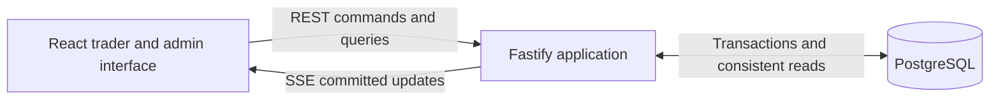

# System architecture and stack

Status: accepted architecture and TypeScript stack, based on the accepted [MVP](MVP.md). Milestone 1 implements the headless trading core, PostgreSQL persistence, and recovery checks. HTTP, authentication, UI, operational workflows, deployment, and performance acceptance remain future work. Exact installed dependencies are pinned in the manifests and lockfile. See [development and validation](DEVELOPMENT.md) for runnable commands and the implemented boundary.

Use a modular TypeScript application, a React interface, and PostgreSQL as the authoritative store. The full MVP will use ordinary HTTP commands and queries and server-sent events for live updates. The implemented core uses exact integer arithmetic and one serialized database transaction for each exchange command. The initial deployment has one application process and one database.

This favors inspectable correctness, a small installation, and approachable contributions. It accepts a throughput ceiling and a single application failure domain. This is a virtual exchange sandbox with one market; it does not need a distributed trading platform to meet its product contract.

## Architecture options

| Option                                                                | Main benefit                                                                            | Cost for this MVP                                                                                                                           | Recommendation                                                                 |
| --------------------------------------------------------------------- | --------------------------------------------------------------------------------------- | ------------------------------------------------------------------------------------------------------------------------------------------- | ------------------------------------------------------------------------------ |
| Modular application with transactional database matching              | One commit can cover an order, both participants, fees, history, and the command result | Commands serialize; database latency limits throughput                                                                                      | Choose for MVP                                                                 |
| Authoritative in-memory engine with durable command log and snapshots | Direct control over execution latency; efficient book operations                        | Must solve durability-before-acknowledgement, deterministic replay, snapshot compatibility, and synchronization with accounting and queries | Consider only after measured need or a deliberate shift toward engine research |
| Separate matching, wallet, identity, market-data, and admin services  | Independent deployment and scaling                                                      | Financial operations cross service boundaries; installation and recovery need substantially more coordination                               | Defer                                                                          |

A modular application still has explicit domain boundaries. Modules communicate through application services and typed interfaces, not arbitrary database writes. Deployment boundaries can change later without pretending that a future engine extraction will be free.

Full event sourcing is also deferred. Immutable ledger entries, order events, command receipts, and an event outbox provide explanation and reliable notification, while committed relational state remains authoritative. Recovery does not require replaying every historical user command.

## Backend language options

| Option                              | Strength for this product                                                 | Principal tradeoff                                                                                        | Fit                                                           |
| ----------------------------------- | ------------------------------------------------------------------------- | --------------------------------------------------------------------------------------------------------- | ------------------------------------------------------------- |
| TypeScript and Node.js              | One language for UI, contracts, domain rules, bot, and most tests         | Requires strict numeric conventions, runtime validation, and bounded synchronous work                     | Best default                                                  |
| Go with a TypeScript UI             | Explicit server code, compiled backend artifact, useful concurrency tools | Two toolchains and generated transport contracts; exactness and transaction correctness still need design | Strong alternative if learning Go is a project goal           |
| Java or Kotlin with a TypeScript UI | Strong transactional ecosystem and exact-number facilities                | More framework/runtime/build surface for this small installation                                          | Good when JVM expertise or experience is an explicit priority |
| Rust with a TypeScript UI           | Strong ownership and error-handling tools; valuable systems practice      | More work to deliver the complete product; memory safety does not establish accounting correctness        | Choose for a Rust-focused project                             |
| Python with a TypeScript UI         | Productive domain development and exact arithmetic options                | Separate language/contracts, with no particular simplification of this interactive product                | Viable, but not the default                                   |

These are fit judgments, not benchmark results. Every option can implement the MVP correctly. Database transaction boundaries and domain invariants matter more than the language's headline performance. At the proposed serialized database boundary, changing Node.js to Go alone would not remove the main throughput limit.

## Recommended stack

| Responsibility                 | Recommendation                                                                        | Reason                                                                                                 |
| ------------------------------ | ------------------------------------------------------------------------------------- | ------------------------------------------------------------------------------------------------------ |
| Frontend                       | React, strict TypeScript, Vite                                                        | A private interactive application with explicit routing and data flow                                  |
| Routing and server reads       | React Router and TanStack Query                                                       | Keep navigation and fetched state explicit; component state is sufficient for forms                    |
| UI foundations                 | Tailwind CSS and a small set of Radix primitives                                      | Build the original interface with reusable controls; keyboard and accessibility checks remain required |
| Chart                          | Lightweight Charts                                                                    | Render internal execution candles without a hosted data dependency                                     |
| Backend                        | Node.js 24 LTS and Fastify                                                            | Shared language, schema-based HTTP boundaries, modular server composition                              |
| Request and response contracts | TypeBox JSON Schemas and OpenAPI                                                      | Runtime validation, response allowlists, TypeScript inference, and a language-neutral documented API   |
| Database                       | PostgreSQL 18                                                                         | Transactional matching, exact storage, locking, consistent snapshots, and operational tooling          |
| SQL access                     | Kysely with the node-postgres driver                                                  | Typed SQL with visible transactions and explicit locking; reviewed migrations                          |
| Live updates                   | REST plus SSE                                                                         | Commands have durable HTTP results; server updates flow over one authenticated stream                  |
| Authentication                 | Opaque PostgreSQL-backed sessions, secure cookies, maintained Argon2id implementation | Username-only access with direct revocation and no hosted identity dependency                          |
| Tests                          | Vitest, fast-check, real PostgreSQL integration tests, Playwright                     | Domain invariants, database races, and observable user flows                                           |
| Repository tooling             | pnpm workspaces, strict TypeScript checks, linting, formatting                        | One repository and a small set of package boundaries                                                   |
| Deployment                     | Docker Compose for application and PostgreSQL                                         | A reproducible self-host installation without a cluster                                                |

Node's official release table identifies 24 as LTS. PostgreSQL's current documentation identifies 18 as the stable line. Use reviewed patches and a lockfile, not floating latest tags. Recheck this baseline if implementation begins after these versions cease to be appropriate. [Node releases](https://nodejs.org/en/about/previous-releases), [PostgreSQL documentation](https://www.postgresql.org/docs/current/)

Fastify supports runtime schemas and TypeBox type providers; static TypeScript types do not replace those checks. Kysely provides an explicit transaction API; all queries participating in a command must use its transaction connection. [Fastify schemas](https://fastify.dev/docs/latest/Reference/Validation-and-Serialization/), [type providers](https://fastify.dev/docs/latest/Reference/Type-Providers/), [Kysely transactions](https://kysely.dev/docs/examples/transactions/simple-transaction), [node-postgres transactions](https://node-postgres.com/features/transactions)

Lightweight Charts requires its notice and TradingView attribution/link to be preserved. Its chart library will display our data; it does not supply market prices. [Official chart repository](https://github.com/tradingview/lightweight-charts)

### Other framework and storage choices

- Vite is preferred to Next.js for this authenticated workspace: there is no MVP requirement for search-engine rendering or server-rendered content. Next.js is viable, but its server features would overlap the dedicated exchange API. Vite supplies both a development server and static builds. [Vite guide](https://vite.dev/guide/)
- Fastify is preferred to Express because request/response schemas and plugin boundaries are part of the chosen design. NestJS would provide more prescribed structure, at the cost of additional framework conventions. Domain logic will remain independent of either framework.
- Kysely is preferred to a large object-mapping layer because transaction scope, row locking, and exact-value conversion should be easy to inspect. Prisma or Drizzle could work; adopting either would not remove the need to review the generated SQL and locking semantics.
- SQLite is a credible alternative for a smaller local-only sandbox, but PostgreSQL is selected for this shared operator/trader workload and its consistent export/recovery design. Supporting two databases would double important concurrency validation work.
- Redis, Kafka, RabbitMQ, a separate cache, a time-series database, GraphQL, and Kubernetes have no required role in this MVP. Revisit a dependency when a measured or newly accepted requirement justifies it.

## Runtime topology



The application process contains HTTP handling, authentication, command orchestration, read queries, the bot scheduler, and event delivery. In a self-hosted release it also serves the built frontend from the same origin. Development runs Vite and the backend in development/watch mode, with Vite proxying API and SSE requests.

There is one supported application instance. A database-held singleton guard prevents accidentally starting a second active bot scheduler/application writer. Acquiring ownership also advances a writer epoch under the installation control-row lock. Every exchange or access-changing command verifies its instance's epoch under that lock; a previous instance cannot continue writing through pooled connections after ownership has changed. Loss of the guard makes the instance unready and stops command/bot dispatch. Ownership acquisition and recovery are ordered after any transaction already holding the control lock. An in-process mutex is not the persistence guarantee. Active-active deployment and automatic failover are excluded.

## Modules and dependencies

| Module                      | Owns                                                                          | Boundary                                                                          |
| --------------------------- | ----------------------------------------------------------------------------- | --------------------------------------------------------------------------------- |
| Identity and access         | Users, roles, credentials, invitations, recovery, login sessions              | Resolves actors and permissions; cannot edit trading balances directly            |
| Exchange domain             | Exact amounts, order rules, matching, fees, reservations, self-trade behavior | Pure deterministic functions; no HTTP, SQL, timers, or hidden clock reads         |
| Command application service | Admission, serialization, idempotency, transaction orchestration              | Only route for orders, fills, allocations, pause/resume, and session changes      |
| Accounting                  | Balanced journal entries and bucket changes                                   | Every financial change is attributable and committed with its originating command |
| Market queries              | Book snapshots, trades, candles, order explanations, history                  | Reads committed data; no independent trading authority                            |
| Operations                  | Pause/resume, restrictions, grants, bot control, rollover, reconciliation     | Uses the command boundary, including administrator actions                        |
| Bot                         | Fixed quoting decisions and scheduled requests                                | Submits through the same application service with its own participant identity    |
| Delivery and exports        | Authorized SSE notifications and consistent CSV exports                       | Cannot fabricate an order outcome or override database state                      |

Repository boundaries, including planned components:

```text
apps/web/                 React views and client state
apps/server/              HTTP, command services, queries, auth, bot, operations
packages/domain/          Pure trading and accounting rules
packages/contracts/       Transport schemas and generated client types
packages/database/        Migrations, typed SQL, transaction adapters
tests/integration/        PostgreSQL concurrency and recovery cases
tests/e2e/                Trader and admin browser flows
docs/                     Product and technical decisions
```

Share transport contracts and exact formatting helpers where useful. Do not expose database row types as API types or bundle server internals into the browser. Separate modules within the server before introducing additional package or deployment boundaries.

## Command acceptance and atomic matching

Use PostgreSQL Read Committed transactions with a lock on one persistent installation control row. Every command affecting orders, reservations, balances, admission restrictions, market state, or session membership acquires that lock before reading mutable exchange state. This row survives session rollover.

The lock deliberately serializes exchange mutations. Concurrent reads remain possible. The application assigns an acceptance sequence while holding the lock; priority follows that sequence, not browser time or arrival at an HTTP socket. This use of explicit locking depends on every relevant writer following the same boundary. [PostgreSQL locking](https://www.postgresql.org/docs/current/explicit-locking.html)

For a normal order command:

1. Authenticate, validate request shape and decimal strings, and identify the submitted command ID and intended exchange session.
2. Begin a transaction, acquire the installation lock, and recheck writer epoch, local admission health, current actor authorization, and account restrictions. Middleware checks alone are insufficient.
3. Look for an existing receipt for this actor and command ID. Return the original result for an identical payload, including after session rollover or preview expiry. Reject reuse with a different payload.
4. For a new command, validate current session, recovery/rollover gates, market state, preview where required, funds, and order limits.
5. Allocate the command/acceptance sequence. Query eligible resting orders in price/time order and pass their state into the pure matching rules. Do not use SKIP LOCKED to bypass a better-priced or earlier order.
6. Persist orders, fills, reservations, both participants' accounting entries, fees, balance projections, explanation events, the command receipt, and notification records in this one transaction.
7. Commit before reporting acceptance or publishing updates. A domain rejection also produces a durable rejected receipt, without reserving funds. Authentication failures and malformed requests are ordinary HTTP failures.

Business rejection and a failed transaction are different. Before commit, a crash leaves no accepted trade. After commit but before the response, a retry with the same identity retrieves the result. Network delivery is not exactly once; the persisted effect is idempotent for that identity. A missing receipt during an unresolved request is not proof that the original command has finished failing.

Keep transactions free of network calls, password hashing, browser interaction, or outbound event delivery. Use deterministic lock ordering after the control row. Limit lock wait and request backlog; overload fails explicitly and does not leave a hidden order scheduled for much later. A canceled request waiting for admission must not continue into an order unnoticed; once admission begins, resolve through its receipt.

The open book initially comes from indexed order rows rather than an authoritative in-memory tree. Index session, side, status, price, and acceptance sequence. Any read cache is disposable and must not decide fills. This reduces recovery complexity, while accepting database work on the execution path.

## Accounting and exact numbers

Use branded scaled-integer values backed by TypeScript bigint in the domain. Decimal strings cross HTTP/JSON boundaries. Reject monetary JSON numbers instead of coercing them into strings during schema validation. Database values are read as strings and converted explicitly. Ordinary JavaScript numbers are never used for financial decisions, reservations, fees, or persistence. Large sequence values and stream cursors also cross the wire as strings or opaque identifiers.

| Value                   | Unit                     |
| ----------------------- | ------------------------ |
| BTC-SIM quantity        | 0.0001 BTC-SIM           |
| Order price             | 0.01 USD-SIM per BTC-SIM |
| USD-SIM balance and fee | 0.000000001 USD-SIM      |

For quantity units q and price units p, the accepted MVP rules give exact quote-unit arithmetic:

```text
fill notional = q * p * 1000
fee for each participant = q * p
buy reservation at its price cap = q * p * 1001
```

Price guards also use integer division with the specified floor/ceiling. Chart coordinates can use bounded approximate numbers for display; chart conversions never flow back into order entry, accounting, or exports. Financial labels and details retain exact decimal strings. Native bigint has different JSON behavior from ordinary numbers, so serialization must be explicit. [BigInt reference](https://developer.mozilla.org/en-US/docs/Web/JavaScript/Reference/Global_Objects/BigInt)

Store atom values as PostgreSQL NUMERIC(38,0), with checked string parsing and representable-range validation before persistence. Add database constraints for valid signs, integer values, uniqueness, and participant balances. PostgreSQL can round values to a declared numeric scale; database coercion must not substitute for the product requirement to reject excess input precision. [PostgreSQL numeric types](https://www.postgresql.org/docs/current/datatype-numeric.html)

Milestone 1 caps an order at 100 BTC-SIM and a price at 100,000,000 USD-SIM per BTC-SIM. Decimal input strings are at most 64 characters, with no whitespace, sign, exponent, or excess precision. Quote atoms fit within NUMERIC(38,0); the largest individual order reservation is 10,010,000,000,000,000,000 atoms, well below that limit. Invalid quantity/price syntax or bounds raise INVALID_QUANTITY / INVALID_PRICE before persistence; a submitted notional below 1 USD-SIM produces a durable ORDER_TOO_SMALL rejection. The 50-resting-order-per-trader admission limit produces OPEN_ORDER_LIMIT. Malformed UUIDs raise INVALID_ID. These are engineering bounds, not claims of realistic market pricing or measured capacity. Grants, aggregate installation/history limits, transport body limits, and export limits still need explicit contracts before those features ship.

Use an append-only double-entry journal balanced separately for each asset. Transfers between available and reserved buckets explain reservations. Trades transfer base and quote assets, with fees going to the system fee account. Grants credit a participant against an explicit virtual-issuance control account; that bookkeeping offset is not a spendable negative customer balance.

Balances are transactionally maintained projections of the journal. Per-order reservations must reconcile with reserved buckets. Commit validation must reject unbalanced journal transactions, while database constraints reject negative participant buckets and duplicate allocations. A normal row CHECK constraint alone cannot establish a multi-row journal sum; use an explicit deferred validation mechanism as part of the database design.

Application roles cannot update/delete committed journal entries, fills, or audit history. This is an application integrity boundary, not a claim of tamper resistance against the database owner.

## Persistent records

The schema design should distinguish these concepts without requiring one table per UI screen:

- Users, roles, authentication sessions, invitations, and recovery tokens.
- Installation control, exchange sessions, immutable session-rule versions, bot intent/generation, and recovery/rollover state.
- Command receipts keyed by actor and command identity, with a payload fingerprint that includes operation and intended session.
- Orders, acceptance sequence, fills, per-order reservations, and explanation events.
- Journal transactions and entries, available/reserved balance projections, fee accounts, and issuance records.
- Administrator actions, protected market previews, committed event outbox, and durable operation progress where a lifecycle spans transactions.

Orders, balances, journal records, and market history are explicitly session-scoped. Receipt lookup remains possible for an archived session. Initial allocations are unique for participant/session/asset. At most one session is active; historical sessions are immutable through application interfaces.

Candles can initially be derived from executions. If an incrementally maintained candle projection is needed, treat it as rebuildable, record its source cursor, and never fabricate missing trades. The last trade price can remain absent even with a populated book.

## Market previews and API behavior

The server creates a market preview from a consistent local-book snapshot and stores a short-lived record bound to actor, exchange session, side, quantity, guard, and expiry. The browser submits that preview identity with the order. Admission rechecks expiry after acquiring the command lock, using current authoritative time. It never trusts a browser-calculated guard or silently reanchors the price.

REST is the supported developer interface, with OpenAPI schemas for exact decimal strings, command IDs, session IDs, stable error codes, and order states. Cookie-jar examples can authenticate and trade without introducing an API-key product. Internal administrator endpoints support the UI; a separately supported administrator automation API remains outside the MVP.

For cookie-authenticated mutations, require CSRF/origin protection. A timeout means the client resolves or retries the original command, not that it generates another identity. Persist receipt fingerprints independently of transport retries. Do not let optimistic UI updates claim fills, released reservations, or a completed administrative operation before the authoritative result.

## Live updates and consistent reads

| Transport     | Benefit                                                 | Tradeoff                                                                            | Decision                        |
| ------------- | ------------------------------------------------------- | ----------------------------------------------------------------------------------- | ------------------------------- |
| Polling       | Smallest initial vertical slice                         | Repeated reads and noticeable refresh lag                                           | Useful during early development |
| REST plus SSE | Durable HTTP commands with one server-to-browser stream | Requires cursor recovery, backpressure, and proxy configuration                     | MVP target                      |
| WebSocket     | Bidirectional persistent messaging                      | More application protocol for commands, authentication, subscriptions, and recovery | Revisit if genuinely needed     |

SSE provides reconnect and event-ID mechanics; durable replay and authorization are application responsibilities. [SSE standard](https://html.spec.whatwg.org/multipage/server-sent-events.html)

Write outbox events in the same transaction as each command's result. A small publisher in the application reads committed events and fans out authorized notifications. No broker is required. A crash after the trade commit but before publication is repaired by reading the outbox again; duplicate delivery is expected and handled.

Start with coalesced invalidation notifications and authoritative snapshot refreshes. This is easier to validate than independently applying optimistic changes to book, funds, orders, and chart caches. Each browser uses one multiplexed SSE connection, not one per panel.

The workspace snapshot reads session state, market data, own balances/orders, and a cursor in one Read Only Repeatable Read transaction, rather than the command path's Read Committed isolation. The stream catches up after that cursor, then continues live. Committed exchange sequence plus event position determines ordering; allocating an ordinary database sequence before commit is not by itself proof of commit order. Serialize client refreshes or discard responses older than the applied session generation and cursor so a delayed response cannot restore stale balances or a previous session.

Outbox replay must filter by current authorization, just like live delivery. Filtered streams legitimately skip unrelated event positions; clients must not interpret every numerical gap as lost personal data. An unavailable/pruned cursor triggers a full fresh snapshot. Bounded client buffers, heartbeats, and reconnect behavior prevent a slow or disconnected browser from receiving an unbounded backlog.

A connection's initial authentication is not perpetual permission. Suspension, password recovery, expiry, or logout closes affected streams; check authorization again before delivering queued private events. Shared payloads do not include participant identities, private order records, or balances. Invitation/recovery secrets never appear in notifications.

For an export, use one Read Only Repeatable Read transaction for all datasets and its as-of manifest. Generate the bounded files promptly, release the database snapshot, then deliver the download. Do not hold that transaction open for a slow download. Keep temporary artifacts outside public/static paths, reauthorize their owner at download time, and delete them after download or expiry. Apply ownership filters and safe CSV encoding, including user-controlled text. PostgreSQL's isolation levels make the snapshot boundary meaningful. [PostgreSQL transaction isolation](https://www.postgresql.org/docs/current/transaction-iso.html)

## Administrator and session transitions

Pause, resume, grants, suspension, initial funding, and bot decisions use the same command boundary as trading. A confirmed pause is ordered after earlier admitted transactions and before later rejections. The bot cannot bypass paused state, funds checks, or session generation.

Suspension revokes access and blocks admission in the serialized command path. When accounting is healthy, cancellation and balance releases occur with the restriction. During an accounting fault, access revocation still commits but financial cancellation remains explicitly pending. Recovery completes the pending cancellations before reporting suspension fully complete.

Session rollover uses a durable operation identity and two transaction boundaries:

1. After confirming the current session is paused and healthy, record a ROLLING_OVER gate and operation ID under the installation lock. Earlier admitted operations finish first. Funding/enrollment mutations then receive temporary-unavailability responses rather than waiting and silently entering a different session.
2. In one transaction, cancel remaining orders, release reservations, close the old session, create and allocate the new session, set its state to paused with the bot stopped, and complete the operation receipt. Old history remains in place under its session identity.

A crash between those transactions leaves a visible recoverable gate. Recovery completes the same operation; it never starts another session or issues duplicate funds. A failure during the second transaction rolls it back wholly. This deliberately uses one bounded rollover transaction for the MVP rather than introducing a multi-service funding saga.

Each command carries its expected session and, where relevant, a control/bot generation. Stale queued bot work and browser forms cannot affect the new session. The bot persists enough intent and outstanding order identity to resume from current state without reissuing starting funds or duplicating quotes. Bot replacement orders still obtain fresh priority as required by the MVP.

## Authentication and recovery

Use established Argon2id password hashing with measured parameters and resource limits. Use opaque random authentication tokens, hashed identifiers at rest, and PostgreSQL session records. Browser cookies are HttpOnly, Secure when served over HTTPS, and SameSite with explicit CSRF/origin checks. Local loopback development is a documented cookie/TLS exception, not the public-hosting configuration. [OWASP password storage](https://cheatsheetseries.owasp.org/cheatsheets/Password_Storage_Cheat_Sheet.html), [session management](https://cheatsheetseries.owasp.org/cheatsheets/Session_Management_Cheat_Sheet.html)

Fastify session/cookie components can supply the HTTP plumbing with a PostgreSQL store adapter; do not use the plugin's default in-memory session store. The application must still own transactional revocation and verify username-only flows. Do not invent fake email addresses to satisfy a framework. Long-lived self-contained JWTs add little when immediate server-side revocation is already required. [Fastify session store interface](https://github.com/fastify/session)

Invitations and recovery tokens are random, hashed, expiring, and atomically single-use. Their plaintext forms are shown only for the required handoff and redacted from logs/exports. Password changes rotate/revoke the required sessions. Invitation redemption and its initial allocation resolve within the same admission boundary, with expensive password hashing performed outside the lock and validity rechecked inside it.

Administrator bootstrap and lost-access recovery are local owner-only CLI operations with a non-echoing password prompt, singleton administrator enforcement, session revocation, and recorded results. Credentials do not appear in command arguments, committed configuration, example files, or generated documentation.

## Restart and operational design

At startup, verify schema compatibility and singleton ownership, then enter recovery before allowing trading or scheduling the bot. Reconcile journal balances, reservation totals, order remaining quantities, fee totals, issuance, session uniqueness, and unfinished lifecycle operations. Receipts resolve ambiguous past requests; accepted orders retain their recorded priority.

If reconciliation succeeds, restore the previous market/bot intentions as specified by the MVP. A stored operator pause remains paused. Failure leaves read-only inspection and access revocation available, while financial mutations remain halted. Graceful shutdown stops admission and bot dispatch, drains transactions, and closes delivery and database connections.

A newly detected runtime invariant failure must latch a halt independently of the failed financial changes. Establish a savepoint after acquiring the control lock, perform financial work and deferred validation inside it, and on an invariant failure roll back to that savepoint before recording the fault gate and failed command result in the outer transaction. Ordinary business rejections do not latch a fault. If the transaction or database connection is unusable, stop local admission immediately, roll back, and persist the halt in a separate transaction when possible; queued commands recheck local admission health under the control lock. Stay unready while the halt cannot be persisted. Recovery must reconcile and finish required pending cancellations before clearing the fault. Never roll back a fault flag together with the failed trade and then continue accepting orders.

Use reviewed explicit migrations under a migration lock. Refuse an incompatible/newer schema and separate the migration role from the restricted application role. Document backup and restore with PostgreSQL tooling and exercise restoration into a fresh database. A persistent container volume alone is not a backup.

Structured logs should identify request, command, exchange session, sequence, and outcome while redacting credentials, cookies, invitation links, recovery links, and private payloads. Collect command latency, lock waits, failed invariants, rejected commands, recovery state, SSE reconnects, and bot inventory conditions. Expose liveness separately from readiness; a recovering service can be alive without being ready to trade.

Development uses PostgreSQL in Compose, Vite's development server, and a backend watch process bound to loopback by default. The release installation uses one app container and PostgreSQL with durable storage; exposing it beyond localhost needs documented TLS/reverse-proxy settings, including SSE buffering/timeouts. No hosted authentication, monitoring, or email account is necessary.

## Validation and delivery order

| Layer                             | Evidence required                                                                                                                                              |
| --------------------------------- | -------------------------------------------------------------------------------------------------------------------------------------------------------------- |
| Domain unit and property tests    | Price/time priority, self-trade rule, exact fees, split-fill equivalence, price improvement, nonnegative spendable funds, balanced transfers                   |
| Real PostgreSQL integration tests | Concurrent reservations, cancel/fill races, identical/conflicting command retries, pause boundary, grants, invitation/rollover races, journal/outbox atomicity |
| Crash and recovery tests          | Failure before commit, after commit before response, after commit before publication, and between rollover stages                                              |
| Authorization tests               | Cross-account data and commands denied; suspended/revoked sessions lose live and replay access; exports enforce scope                                          |
| Browser tests                     | Accepted MVP cases A01 through A16, with realistic connection loss and session changes                                                                         |
| Operational tests                 | Fresh installation, migration compatibility, backup/restore, bot restart, and coherent exports under ongoing trading                                           |

Use a real disposable PostgreSQL database for transaction tests. Mocked repositories and SQLite cannot establish PostgreSQL lock or snapshot behavior. Tests should exercise guarantees and races, not merely repeat implementation statements.

An initial performance-validation workload is 20 connected traders, up to 1,000 human resting orders, the bot preset, and 20 mutating commands per second. Measure command completion, lock wait, recovery, and live-update delay on documented reference resources. This is a proposed test workload, not a proven capacity or a new participant limit. Agree numeric latency and resource targets before declaring performance acceptance.

Implementation order:

1. Exact domain values, matching/accounting rules, and technical numeric bounds — implemented. HTTP contract schemas remain part of the API milestone.
2. PostgreSQL schema and transactional vertical slice proving the MVP partial-fill/cancel example, duplicate-command recovery, and invariant checks — implemented; see the development guide for test evidence and limitations.
3. Invitations/authentication and administrator gates, grants, bot control, rollover, and recovery cases.
4. Trader/admin UI, protected previews, live synchronization, and explainable history.
5. Exports, self-host setup, restore drill, full browser acceptance, and measured workload validation.

These increments are implementation order, not separate weakened definitions of done. Accounting and recovery are prerequisites for the polished trading experience.

## Limits and revisit conditions

The global command lock is an intentional bottleneck. Large books, long exports, unbounded archives, heavy reconciliation, or expensive computation can still harm responsiveness. Keep work and buffers bounded, and measure before claiming capacity.

Revisit in-memory matching or engine extraction if measured command latency/throughput misses agreed targets after SQL and transaction work are profiled. Revisit per-market serialization only if multiple markets become accepted scope, including how cross-market account funds stay consistent. Add a broker or more application replicas only when delivery or deployment requirements require them and leader/fencing semantics are designed.

Before implementing the remaining adapters, settle their input/export bounds and the initial latency/resource test target. Before public release, choose the project's open-source license and preserve dependency notices. Real funds remain outside the accepted scope.
