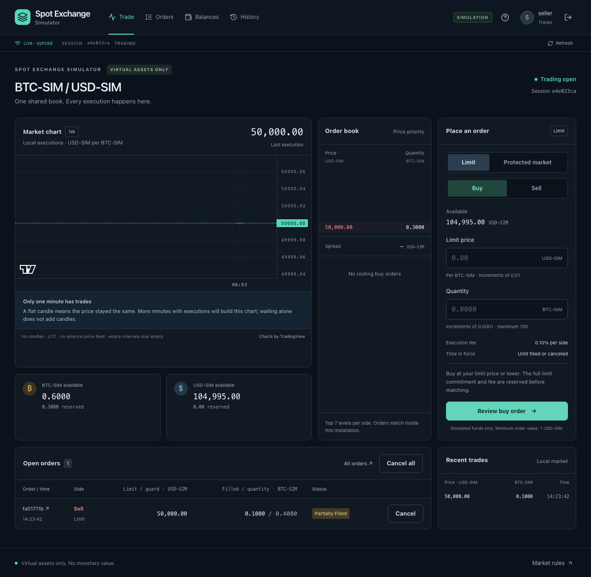
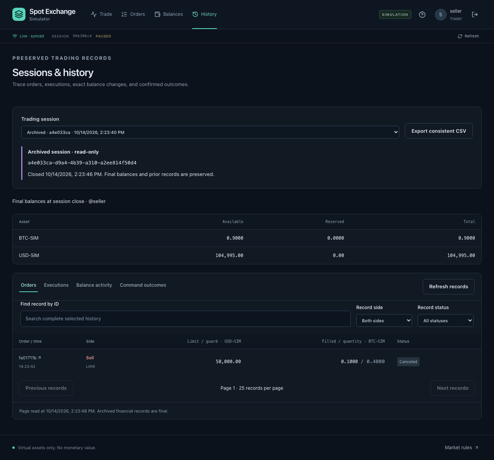

# Self-host release and portfolio verification

The release target is an open-source repository that other people can run themselves. A hosted demonstration is outside the current delivery. The [MIT license](../LICENSE) covers the source. All balances and executions remain virtual; see the accepted [MVP](MVP.md) for product boundaries.

## Review the project locally

Use the [README quick start](../README.md#run-locally) for the development application. It starts the API in watch mode, Vite, and persistent local PostgreSQL. The self-host package below is a separate deployment artifact; it does not replace the development workflow or reset its database.

```sh
pnpm install --frozen-lockfile
pnpm exec playwright install chromium
pnpm check
pnpm demo
```

The test and demo wrappers create isolated temporary PostgreSQL clusters. CI uses its separate PostgreSQL service. Browser tests run actual development pages and APIs in independent schemas, including lost responses and real preview expiry. Process-loss tests send `SIGKILL` at known transaction boundaries.

## Walkthrough

Use two browser profiles for the two traders. Keep the simulator stopped for the exact arithmetic demonstration.

1. Create the administrator with `pnpm admin:setup`, start `pnpm dev`, and sign in. Invite two traders and redeem their links in separate profiles. Each receives 1 BTC-SIM and 100,000 USD-SIM.
2. Resume trading. The seller reviews and places a limit sell for 0.4 BTC-SIM at 50,000 USD-SIM. The buyer purchases 0.1 at that price. Inspect the seller's partial fill, 0.3 remaining quantity, and both 5 USD-SIM fees.
3. Cancel the seller's remainder. The seller finishes with 0.9 BTC-SIM and 104,995 USD-SIM; the buyer with 1.1 BTC-SIM and 94,995 USD-SIM. Neither retains a reservation for those orders, and the fee account holds 10 USD-SIM.
4. Inspect each order's executions and linked balance activity. Export the account files or the administrator's complete session bundle; keep its manifest with the CSV files.
5. Pause the market. Review **Start a new session**, enter a reason, and confirm the full old session identity. Both traders move to the new paused session with fresh allocations. In **History**, select the old archive and verify the earlier final balances and canceled order.
6. Start the simulator and resume. Its ordinary orders create synthetic liquidity and executions. Review a protected market order's fixed guard and estimates; expiry requires a fresh review. More one-minute candles require trading in more real minutes.

The source browser scenarios reproduce the rollover, archive, pagination, export, and lost-acknowledgement portions automatically:

```sh
pnpm test:browser --grep 'rollover|complete history'
pnpm test:integration tests/integration/session-lifecycle.test.ts tests/integration/session-repair.test.ts
```





Screenshots come from isolated browser-test accounts and virtual funds. They contain no invitation, recovery, password, or authentication secrets. To refresh them deliberately, run the matching rollover browser scenario with `CAPTURE_PORTFOLIO_SCREENSHOTS=1`; ordinary CI does not rewrite tracked images.

## Self-host package

`Dockerfile` supplies API, web/proxy, and owner-operated verification targets. `compose.yaml` supplies PostgreSQL with persistent storage, a one-shot migration service, the API, and a Caddy frontend serving the built React application. PostgreSQL and the API have no published host ports. The browser uses one HTTPS origin for static files, cookies, HTTP commands, and SSE.

Base images are pinned by version and digest. Workspace dependencies install from the frozen lockfile; global pnpm and TypeScript loader tooling use explicit versions. Owner credentials belong only to migration and explicitly invoked operation tooling. The application runs as an unprivileged container user and uses a separate restricted database role. Its startup verifies the exact migration set rather than running DDL. Administrator creation and credential recovery remain interactive owner commands with hidden password entry; no universal administrator credentials are installed.

Generated configuration and secrets live under ignored `.local/self-host/`. Preparation requires an explicit HTTPS origin and preserves existing files rather than replacing credentials. Keep these files and persistent volumes private. Use a hostname you control, with DNS and ports configured for that machine. Caddy obtains the certificate for the configured hostname. For owner-local verification, `localhost` uses Caddy's private development authority; trust its exported root certificate explicitly in the client rather than disabling certificate verification.

```sh
pnpm selfhost:prepare https://exchange.example
# Use the real HTTPS origin for your installation in the command above.
docker compose --env-file .local/self-host/compose.env build
docker compose --env-file .local/self-host/compose.env up -d postgres
docker compose --env-file .local/self-host/compose.env run --rm migrate
docker compose --env-file .local/self-host/compose.env run --rm operator setup
docker compose --env-file .local/self-host/compose.env up -d api web
```

Run operator setup in an interactive terminal and choose your own administrator credentials. `.local/self-host/compose.env` contains the public origin/host/port settings; actual database secrets are separate private files. A custom HTTPS port is preserved by the HTTP redirect. Local testing can bind `BIND_HOST=127.0.0.1` and select unused ports in that private environment file.

To upgrade, back up first, stop the API/web, rebuild, run `migrate`, then restart. Run `operator reset` only for owner-authorized administrator credential recovery while the API is stopped. Ordinary `docker compose down` retains volumes; removing them is a separate destructive action. Back up database contents and the private connection configuration through your own protected backup process.

The deployment trusts exactly one private proxy hop for client authentication throttling. Caddy sanitizes forwarded client headers; keep the backend port private and retain the default zero-hop setting when running a direct development API. The runtime database role cannot create/alter/drop schema objects, rewrite migration metadata, or assume an owner role. Provisioning rejects a pre-existing role that owns objects rather than silently claiming it is restricted.

## Operational evidence

A backup exercise restores a PostgreSQL custom-format dump into a new database, compares retained records, reopens the exchange, reconciles accounting, and replays original trading and rollover receipts. Temporary verification databases and files are owned by that exercise. A successful application-process restart alone is a different guarantee from a verified database restore.

Use PostgreSQL 18 `pg_dump`/`pg_restore` for `pnpm ops:restore`; `PG_DUMP_BIN` and `PG_RESTORE_BIN` select explicit compatible client binaries. The operations image includes matching tools:

```sh
docker compose --env-file .local/self-host/compose.env --profile tools build operations
docker compose --env-file .local/self-host/compose.env --profile tools run --rm operations
BENCHMARK_PAIRS=1000 pnpm ops:benchmark
```

The Docker restore exercise uses the configured PostgreSQL service to create fresh generated databases, then removes those databases after verification. It does not restore over an existing installation. Reports and the private generated fixture dump are retained under ignored `.local/operations/`. Commit only the reviewed, sanitized JSON evidence; never commit a database dump or its authentication material.

The reproducible workload measures committed matching commands against real PostgreSQL, reports latency and throughput for its explicit configuration, and checks financial reconciliation and receipt replay. It identifies the runtime, platform, workload, and concurrency without machine or user identifiers. Results establish the measured workload only; they do not claim general hosting capacity, internet latency, or real-money readiness.

## Recorded local operational results

The 2026-10-14 [self-host report](evidence/container-smoke-result.json) records actual container builds and HTTPS requests through Caddy using an explicitly trusted local CA. It covers deep-link routing, secure cookies, CSRF, invitations, protected market execution, exact accounting, SSE proxy delivery, rollover, archives, and original receipt replay. The API's non-root user and restricted database connection were checked separately. Test-owned containers and volumes were removed afterward.

The [restore report](evidence/restore-result.json) compared all 22 tables before reopening the restored writer. Its generated fixture includes three users, redeemed and pending invitations, a recovery token, a grant, both simulator accounts, a protected market preview/use, a completed rollover, and old/new-session financial records. Login, preview preservation, original order/rollover receipts, and reconciliation passed after restore. The fixture dump itself is private and excluded from Git.

The [workload report](evidence/benchmark-result.json) used Node.js 24.19.0, PostgreSQL 18.4, and an Apple M1 Pro with 10 logical CPUs and 16 GiB memory. Ten warmup pairs per caller were excluded; each measured caller then submitted 1,000 limit sell/buy pairs. These are direct core calls with matching, journal writes, and database commit included.

| Concurrent callers | Measured commands | Duration | Commands/second | p50       | p95       | p99       |
| ------------------ | ----------------- | -------- | --------------- | --------- | --------- | --------- |
| 1                  | 2,000             | 6.37 s   | 313.89          | 3.091 ms  | 4.743 ms  | 6.711 ms  |
| 4                  | 8,000             | 33.60 s  | 238.09          | 16.145 ms | 26.418 ms | 34.756 ms |

All measured commands were accepted, with zero errors, successful financial reconciliation, and identical receipt replay after reopening the writer. Four concurrent callers increased latency and reduced observed throughput, exposing contention at the serialized boundary. These short runs measure the disclosed workload; HTTP, password hashing, TLS, live clients, sustained load, and saturation behavior are separate measurements. Use the scripts and method to reproduce results, rather than treating these figures as a deployment capacity promise.

## MVP acceptance evidence

Use the scenario definitions in [MVP release acceptance](MVP.md#release-acceptance-criteria). The table identifies evidence to inspect, rather than treating a test count as complete product acceptance.

| Criteria                              | Evidence                                                                                                                               |
| ------------------------------------- | -------------------------------------------------------------------------------------------------------------------------------------- |
| A01 fresh installation                | Owner setup, isolated self-host smoke verification, and invitation/first-trade browser workflow                                        |
| A02 invitations and ownership         | API/auth integration tests, scoped history/export tests, invitation browser workflow                                                   |
| A03–A04 partial fill and cancellation | Trading integration tests, trader browser workflow, exact walkthrough above                                                            |
| A05 ordering and self-trade           | Domain examples/properties and PostgreSQL trading/market-order tests                                                                   |
| A06 guarded execution                 | Market-order domain/integration tests and protected-market browser scenarios                                                           |
| A07 reservations and fees             | Domain conservation/split-fill properties and concurrent reservation integration tests                                                 |
| A08 retry and recovery                | Trading/admin/simulator/rollover receipts, actual process-kill tests, reload/retry browser scenarios, database restore exercise        |
| A09 operator controls                 | Auth/admin recovery and simulator integration tests; administrator browser workflow                                                    |
| A10 simulator lifecycle               | Simulator/core integration tests and audited controls/inventory/funding browser workflow                                               |
| A11 rollover                          | Session lifecycle/reconciliation tests, three rollover process-kill boundaries, and live transition/archive browser workflow           |
| A12 market truth                      | Workspace/candle tests and simulator integration/browser scenarios; explicit empty/sparse chart states                                 |
| A13 explainability and export         | Order/account inspection tests, complete history tests, actual CSV-download browser scenario                                           |
| A14 developer onboarding              | Documented HTTP examples and API route/authorization integration tests                                                                 |
| A15 fault and rollover boundaries     | Gated enrollment/funding/reinstatement tests, faulted-transition repair/retry tests, access-revocation checks                          |
| A16 coherent live export              | Concurrent-commit export test with one Repeatable Read snapshot, exact balance/fee totals, role scopes, and recorded manifest boundary |

The new archive browser scenario also verifies a 390 × 844 viewport without document overflow, readable session/export/pagination controls, and Escape restoring focus after closing read-only order details. The isolated HTTPS/proxy smoke report supplements the development-browser scenarios. Local verification is recorded in [development evidence](DEVELOPMENT.md#evidence-and-limitations). A remote GitHub Actions run requires publishing the repository; no remote success is inferred from local results.

## Contributing and publishing

Keep financial amounts exact, preserve durable command identities, and make ownership/session checks part of the transaction boundary. Add tests for changed guarantees and keep the MVP, architecture, API, and development docs consistent. Run `pnpm check` before proposing a change. Use development mode for ordinary local work.

Before publishing, verify that Git tracks no `.local`, `.env`, database dump, password, cookie, token, or generated test artifact. The committed screenshots use test-only identities. The repository contains an original interface, the accepted architecture tradeoffs, runnable examples, verification scripts, and the MIT license. Choose the destination GitHub repository separately; configuring a remote and pushing are explicit publication actions.
